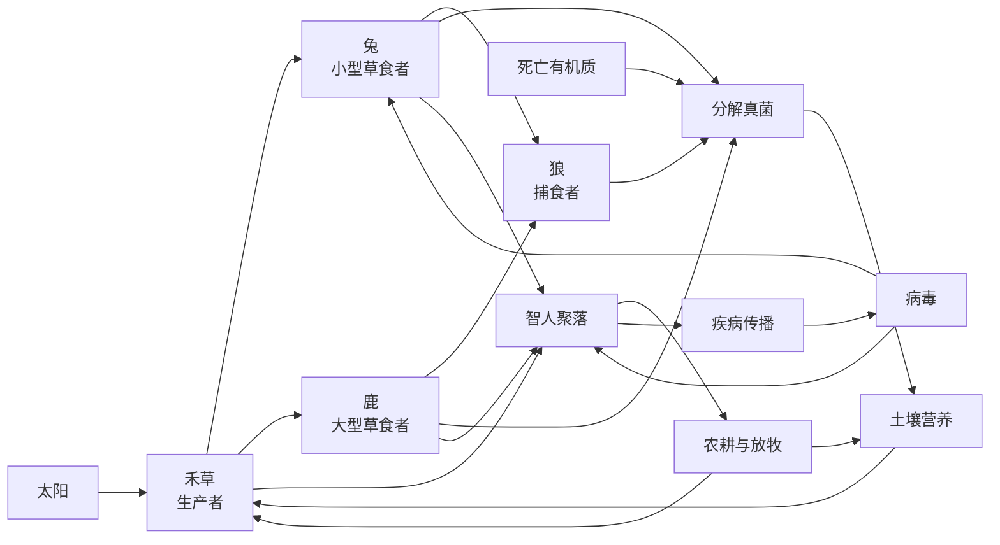
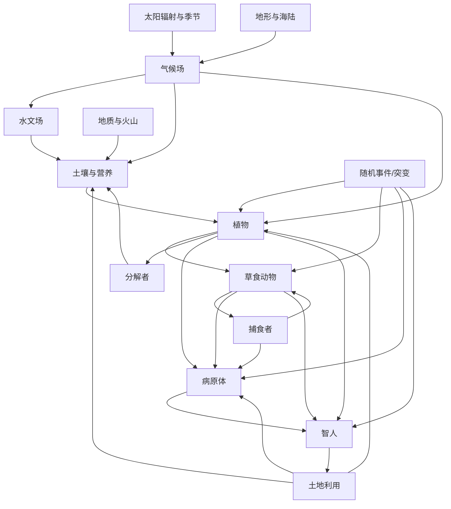

# ECO WORLD 项目执行契约 v2.2

> 本文档是 v1「总设计文档」的落地版本。v1 决定“做什么、为什么”，本文档决定“怎么做、按什么顺序做、谁来做、做完怎么验收”。
> 本文档是**执行契约**：其中所有公式、单位、数据结构、更新顺序和文件树均为**冻结项**，后续 agent 不得自行修改；只能按 §17 的任务模板补数据、补函数体、补测试。

> **v2.2 变更记录（2026-11-16，项目 owner 批准架构变更提案 docs/05-hex-grid-proposal.md，Q6）**：
> - **方形网格 → 六边形蜂窝网格**（文明式）。§1.2 几何：中心距 d=10km（`CELL_EDGE_KM` 语义改为中心距）、边长 d/√3≈5.774km（新增 `CELL_HEX_SIDE_KM`）、面积 (√3/2)d²≈86.60km²（`CELL_AREA_KM2` 100→86.60）。
> - §1.3 坐标协议：**odd-r offset 存储**（`Cell.id{x=col,y=row}`，W×H 矩形布局）+ **cube 坐标运算**；**6 邻域**为计算邻域；**纬度公式保留** `lat=90−180(row+0.5)/H`；边界墙保留。
> - §3.1 `Cell.neighbors` 4 项→6 项（字段名/类型不变）；§13 新增 `grid/hex.ts`、`docs/05-hex-grid-proposal.md`。
> - **公式层零改动**：E1–E6/B1–B8/§9.2 顺序/随机接口/快照/重放全部不变（拓扑无关）；E4 汇流、B9 扩散、海岸 BFS 为通用邻居图算法，自动适配 6 邻域。坡度/坡向改 6 邻居最小二乘平面拟合（scenario.ts）。
> - 证据：定殖前沿各向异性支撑比 方形 √2=1.414（偏差 41%）→ 六边形 2/√3=1.155（15%），改造后实测 1.1547。M0–M3 验收在六边形上全部重新通过（103 测试 102 过 0 败）。
> - Q9/Q10（M2/M3 非冻结接口/算法）仍待 v2.2 后续冻结，不在本次 hex 变更内。

> **v2.1 变更记录（2026-11-16，项目 owner 批准）**：
> - **Q4 解决**：§2 补充 E1–E5 引用的 6 个常量（`SOLAR_AMPLITUDE_DAY` / `SEASON_AMP` / `INFILTRATION_CAPACITY` / `EVAP_RATE` / `MAX_SURFACE_WATER` / `MAX_NUTRIENTS`），冻结；新增 `HYDROLOGY` / `SOIL` 常量组。
> - **Q6 决策**：保持方形网格 / 4 邻域（§1.3）至 M2 闭环验收通过；六边形网格留作后续架构变更提案候选。
> - Q5 / Q7 的 v2.1 增补提案（§3.7 地形生成器、§13 数据构建脚本追认）仍待决，不在本次变更内。

---

## 0. 文档目的与阅读方式

### 0.1 目的

让后续 agent 的工作全部变成**标准化执行**，而不是项目决策。一个 agent 拿到任务卡后，应当能只靠本文档回答：

1. 我要改哪个文件、哪个函数？
2. 这个函数的输入输出类型和单位是什么？
3. 公式编号是多少，默认参数是多少？
4. 边界条件是什么？
5. 验收样例是什么？

### 0.2 阅读顺序

| 角色 | 先读 | 再读 |
|---|---|---|
| 架构负责人 | §1–§4 | §13–§14 |
| 模拟/公式 agent | §3–§9 | §18 |
| 内容 agent | §12、§15 | §17 |
| 前端 agent | §10–§11 | §13 |
| 测试 agent | §18 | §17 |

### 0.3 冻结与可改

- **冻结项**：单位系统、坐标协议、数据结构字段名、公式编号与默认参数、更新顺序、随机数接口、文件树。修改必须走“架构变更提案”。
- **可改项**：物种具体数值、群系配色、图鉴文案、前端样式、缓存策略、测试样例的扩充。
- **禁止项**：agent 在局部实现时静默重写规则。发现规范不可实现时，提交问题单 + 最小修改建议，不自行改规范。

---

## 1. 冻结决策与量纲总表

### 1.1 世界本质

世界底层是**连续环境场**（温度、降水、水分、营养等），生物按尺度采用四种表示：

| 表示 | 对象 | 示例 |
|---|---|---|
| 连续场 | 环境变量 | 温度、降水、营养 |
| 种群场 | 同物种在一个 cell 的集合 | 兔 320 只/cell |
| 个体代理 | 少数重要个体 | 首领、异常个体 |
| 关系网络 | 物种间/人类间关系 | 食物网、贸易 |

### 1.2 单位系统（冻结）

| 量 | 单位 | 说明 |
|---|---|---|
| 时间 | day（天） | 最小生态 tick；year = 365 day |
| 空间 | cell | 六边形逻辑单元（v2.2）；中心距 d = 10 km，边长 d/√3 ≈ 5.774 km |
| 面积 | km² | cell.area = (√3/2)d² ≈ 86.60（v2.2，原方形 100） |
| 生物量 | kgC | 千克碳/干重，与 v1 “biomass”一致 |
| 种群数量 | individuals / cell | 动物、人 |
| 植物量 | kgC / cell | 植物用生物量，不用株数 |
| 能量 | kJ | 所有能量流统一 |
| 温度 | °C | 允许负值 |
| 降水 | mm/day | 每天降水量 |
| 水储量 | mm | 单位面积水深，1 mm = 1 L/m² |
| 营养 | kgN / cell | 抽象为可利用氮当量 |
| 质量 | kg | 个体体重 |
| 距离 | km | 移动、扩散 |
| 密度 | individuals / km² | 展示层换算 |

### 1.3 坐标协议（冻结，v2.2 六边形）

- 逻辑层：**六边形蜂窝网格**（pointy-top），**odd-r offset 存储**：`Cell.id {x=col, y=row}`，`col ∈ [0, W)`, `row ∈ [0, H)`，默认 `W = H = 128`，矩形布局（奇数行右移半格）。
- 运算坐标：**cube 坐标** (cx,cy,cz)，cx+cy+cz=0。offset→cube：`cx = col − (row − (row&1))/2`，`cz = row`，`cy = −cx−cz`；cube→offset：`col = cx + (cz − (cz&1))/2`，`row = cz`。工具见 `grid/hex.ts`。
- 邻居：**6 邻域**为计算邻域（cube 六方向 `[(+1,−1,0),(+1,0,−1),(0,+1,−1),(−1,+1,0),(−1,0,+1),(0,−1,+1)]` 转 offset）；格距 = `(|Δcx|+|Δcy|+|Δcz|)/2`。
- cell 中心 Cartesian（km）：`px = d·(col + 0.5·(row&1))`（东向），`py = d·(√3/2)·row`（南向）；经度 `lon = 360·(col + 0.5·(row&1))/W − 180`。
- 环面还是边界墙：默认**边界墙**（越界邻居过滤，不环回），避免假迁徙。
- `latitude` 用 `row` 归一化（**公式保留**）：`lat = 90 - 180 * (row + 0.5) / H`，范围 `[-90, 90]`。
- 所有字段名与 §3 完全一致，禁止别名（`id{x,y}` 语义为 offset col,row）。

---

## 2. 全局常量与默认参数

```ts
export const WORLD = {
  W: 128,                 // 列数（odd-r offset col）
  H: 128,                 // 行数（odd-r offset row）
  CELL_EDGE_KM: 10,       // 六边形中心距 spacing（v2.2：原方形边长语义改为中心距）
  CELL_HEX_SIDE_KM: 10 / Math.sqrt(3), // 六边形边长 ≈ 5.7735 km（v2.2 新增）
  CELL_AREA_KM2: (Math.sqrt(3) / 2) * 100, // 六边形面积 ≈ 86.60 km²（v2.2：原 100）
  DAYS_PER_YEAR: 365,
  SEASON_LENGTH_DAYS: 91, // 约一季度
  TICKS_PER_DAY: 1,       // 生态 tick
};

export const CLIMATE = {
  SOLAR_AMPLITUDE: 40,        // 纬向温度振幅 °C（赤道↔极地）
  BASE_MEAN_TEMP: 14,         // 全球平均 °C
  LAPSE_RATE: 6.5e-3,         // 温度随海拔递减 °C/m
  OCEAN_MODERATION: 0.6,      // 海洋削弱季节振幅的比例
  RAIN_SHADOW_FACTOR: 0.5,    // 背风坡降水折扣
  MAX_PRECIP_MM_DAY: 60,      // 单日降水上限
  SOLAR_AMPLITUDE_DAY: 0.65,  // E1 辐射季节振幅（无量纲；赤道输出≈[0.35,1.65]）【v2.1/Q4】
  SEASON_AMP: 15,             // E2 季节温度振幅 °C（海洋按 OCEAN_MODERATION 削弱）【v2.1/Q4】
};

export const HYDROLOGY = {    // 【v2.1/Q4 新增常量组】
  INFILTRATION_CAPACITY: 20,  // E4 日入渗上限 mm/day
  EVAP_RATE: 2,               // E4 蒸发基准 mm/day（20°C、湿度0.5 → 3 mm/day）
  MAX_SURFACE_WATER: 1000,    // E4 地表水深上限 mm，超出转 downstreamFlow
};

export const SOIL = {         // 【v2.1/Q4 新增常量组】
  MAX_NUTRIENTS: 1000,        // E5 有效氮库上限 kgN/cell
};

export const BIOLOGY = {
  HANDLING_TIME_DEFAULT: 0.05,   // 捕食处理时间 (1/day)
  ATTACK_RATE_DEFAULT: 0.008,    // 攻击率 (1/(ind·day))
  STARVATION_FLOOR: 0.02,        // 最低存活能量比例
  DENSITY_KNEE: 0.5,             // 密度制约拐点
};
```

> 这些默认值被公式引用。内容 agent 录入物种时只能覆盖物种级参数，不能覆盖全局常量。
> 【v2.1/Q4】标注的 6 个常量于 2026-11-16 经项目 owner 批准冻结（问题单 Q4 最小修改提案原文见 `docs/03-agent-tasks.md`）。

---

## 3. 核心数据结构（带单位）

### 3.1 Cell（地理单元）

```ts
interface CellId { x: number; y: number }

interface Cell {
  id: CellId;
  // 静态（地质/地形，慢变）
  elevation: number;              // m
  slope: number;                  // 0..1
  aspect: number;                 // rad, 0=北
  terrainType: TerrainType;
  geologicalType: GeologicalType;
  landWaterFraction: number;      // 0..1, 0=全陆地 1=全水
  coastDistance: number;          // km
  latitude: number;               // deg
  neighbors: CellId[];            // 6 邻域（v2.2 六边形，odd-r offset）

  // 动态环境场
  temperature: number;            // °C
  precipitation: number;          // mm/day
  humidity: number;               // 0..1
  soilMoisture: number;           // mm 有效水
  surfaceWater: number;           // mm 地表水
  groundwater: number;            // mm 地下水
  nutrients: number;              // kgN/cell
  oxygen: number;                 // 0..1 饱和度
  salinity: number;               // g/L
  organicMatter: number;          // kgC/cell 死亡有机质
  diseasePressure: number;        // 0..1
  pollution: number;              // 0..1
  fireRisk: number;               // 0..1

  // 派生（缓存）
  biome: BiomeType;
  carryingCapacity: Record<string, number>; // speciesId -> kgC or ind
  accessibility: number;          // 0..1
  productivity: number;           // kgC/(cell·day) 净初级生产力
}
```

### 3.2 SpeciesDefinition（物种模板，稳定数据）

```ts
interface SpeciesDefinition {
  id: string;                     // 命名规则见 §17.4
  taxonomy: Taxonomy;
  roles: FunctionalRoles;         // 0..1 权重，用于食物网绘制与粗分类
  physiology: Physiology;
  environment: EnvironmentPreference;
  resources: ResourceProfile;
  lifeHistory: LifeHistory;
  movement: MovementProfile;
  interactions: InteractionProfile;
  genetics: GeneticsProfile;
  disease: DiseaseProfile;
  ecosystemEffects: EcosystemEffectProfile;
  simulationTier: 'field' | 'population' | 'agent' | 'network';
}
```

### 3.3 PopulationState（种群运行时状态）

```ts
interface PopulationState {
  speciesId: string;
  cellId: CellId;
  count: number;                  // ind/cell（植物为 kgC 存于 biomass 字段）
  biomass: number;                // kgC/cell
  ageStructure: { juvenile: number; adult: number; old: number }; // 比例和
  energyReserve: number;          // kJ/ind 平均
  health: number;                 // 0..1
  infectionState: Record<string, number>; // pathogenId -> 感染个体比例 0..1
  traitMeans: Record<string, number>;     // 性状均值
  traitVariance: Record<string, number>;
}
```

### 3.4 WorldSnapshot（时间步快照，不可变）

```ts
interface WorldSnapshot {
  time: number;                   // day
  season: number;                 // 0..1（年相位）
  cells: Cell[];
  populations: PopulationState[];
  agents: AgentState[];
  interactions: InteractionState[];
  events: HistoricalEvent[];
  randomState: string;            // 随机流序列化
}
```

### 3.5 其他关键类型

```ts
type TerrainType = 'mountain' | 'hill' | 'plain' | 'river' | 'lake' | 'ocean' | 'wetland';
type BiomeType = 'tropical_forest' | 'seasonal_forest' | 'temperate_forest' | 'grassland'
               | 'desert' | 'tundra' | 'wetland' | 'freshwater' | 'coastal_ocean' | 'deep_ocean';

interface Range { min: number; max: number }

interface Taxonomy {
  domain: string; kingdom: string; phylum?: string; className?: string;
  order?: string; family?: string; genus?: string;
  speciesName: string; fictional: boolean;
}

interface FunctionalRoles {
  producer: number; herbivore: number; carnivore: number; omnivore: number;
  decomposer: number; pollinator: number; parasite: number; pathogen: number;
  ecosystemEngineer: number;
}
```

---

## 4. 环境场公式（E 系列）

> 所有公式的输入输出单位和默认参数见 §2。每个 cell 每 tick 计算一次。公式编号写入代码注释，便于追溯。

### E1 太阳辐射（季节与纬度）

```
solarInput(lat, day) = 1 + SOLAR_AMPLITUDE_DAY * sin(2π · day / 365)
                        · cos(rad(lat))
```

- 输入：纬度 lat（deg）、年内日 day。
- 输出：无量纲辐射强度，范围约 [0.3, 1.6]。
- 用途：温度与光合的乘法因子。

### E2 温度

```
temperature = BASE_MEAN_TEMP
            - SOLAR_AMPLITUDE * |sin(rad(lat))|
            - LAPSE_RATE * elevation
            + SEASON_AMP * seasonPhase(lat)          // 季节项
            - OCEAN_MODERATION * landWaterFraction * seasonalAmplitude
            + greenhouseDelta
            + weatherNoise                             // 见 §8
```

- `seasonPhase` 随纬度与半球改变符号（北半球与南半球反相）。
- 边界：温度允许超出 [−60, 60]，但超出 [−70, 70] 时截断并记录事件。
- 雨影、洋流等地理修正放在“区域修正表”而非公式内，避免局部特判污染核心。

### E3 降水

```
precipitation = moistureSource
              * transportFactor(lat, windDirection)
              * orographicLift(slope, aspect, windDirection)
              * seasonalFactor(day)
              * stormNoise
```

- `orographicLift`：迎风坡 `> 1`，背风坡 `= RAIN_SHADOW_FACTOR`。
- 边界：`precipitation ∈ [0, MAX_PRECIP_MM_DAY]`，负值截为 0。

### E4 水文（水量平衡）

```
surfaceWater_next = surfaceWater
                  + precipitation
                  + upstreamFlow
                  - evaporation
                  - infiltration
                  - downstreamFlow
                  - consumption
```

- `upstreamFlow` / `downstreamFlow` 由邻居高差与流量方向决定（水流向低处）。
- `infiltration = min(precipitation, INFILTRATION_CAPACITY)`。
- `evaporation = EVAP_RATE * (1 + 0.1 * temperature) * (1 - humidity)`。
- 边界：所有水量 `≥ 0`；超过 `MAX_SURFACE_WATER` 的部分转为 `downstreamFlow`。
- 河流结构由 §14 的 `computeFlowDirection` 一次性求出流向矩阵缓存，不逐 tick 重算。

### E5 土壤与营养

```
nutrients_next = nutrients
               + decomposition(organicMatter, fungiActivity)
               + fixation
               - plantUptake
               - leaching(soilMoisture)
               - erosion(slope, precipitation)
```

- `plantUptake` 由所有植物按生物量分配，见 §5。
- 边界：`nutrients ∈ [0, MAX_NUTRIENTS]`。

### E6 生物群系分类

```
biome = classify(temperature, precipitation, seasonality,
                 soilMoisture, elevation, salinity, vegetationStructure)
```

- 分类表冻结在 `content/biomes/biome-rules.json`，只做查表，不做 if 堆积。

---

## 5. 生物模型公式（B 系列）

### B1 光合作用（植物）

```
GPP = P_MAX * lightFactor(solarInput) * tempFactor(temperature)
    * waterFactor(soilMoisture) * nutrientFactor(nutrients)
    * speciesEfficiency * seasonFactor
```

- `P_MAX`：物种最大总初级生产力，单位 kgC/(cell·day)。
- 各因子为 0..1 的饱和/高斯函数，代码见 §14 骨架。
- 边界：因子为负或超 1 时截断到 [0,1]。

### B2 呼吸损耗

```
respiration = maintenanceRespiration * biomass
            + growthRespiration * max(0, GPP - maintenanceRespiration * biomass)
```

### B3 植物生长

```
growth = GPP - respiration - herbivory - diseaseLoss - droughtDamage - competitionLoss - fireLoss
biomass_next = clamp(biomass + growth, 0, maxBiomass)
```

### B4 出生

```
births = adults
       * reproductionRate
       * foodModifier
       * healthModifier
       * mateAvailability
       * seasonalModifier
       * densityModifier
```

- `densityModifier = 1 / (1 + DENSITY_KNEE * (count / carryingCapacity))`。
- 边界：`births ∈ [0, adults * reproductionRate]`。

### B5 死亡

```
deaths = population
       * baselineMortality
       * starvationModifier
       * diseaseModifier
       * predationModifier
       * climateStressModifier
       * randomMortality
```

- `starvationModifier`：能量储备低于 `STARVATION_FLOOR` 时指数上升，见 §14。

### B6 捕食（Holling II）

```
consumption = (attackRate * predatorCount * preyCount)
              / (1 + attackRate * handlingTime * preyCount)
```

- 单位：prey ind/day。
- 捕食者获得的能量：`energyGain = consumption * preyEnergyDensity * conversionEfficiency`。
- 边界：`consumption ≤ preyCount`；捕食者不产生负能量。

### B7 竞争

```
effectiveResource = resourceAmount
                  / (1 + Σ_j competitionCoefficient_j * competitorDensity_j)
```

### B8 适合度（乘法型）

```
fitness = baseFitness
        * temperatureSuitability
        * moistureSuitability
        * foodSuitability
        * oxygenSuitability
        * diseaseModifier
        * competitionModifier
        * predationModifier
        * randomnessModifier
```

- 每个 suitability 由物种 `EnvironmentPreference` 的 Range 与当前环境值经宽容函数映射到 0..1。
- 硬致死条件（如温度超出绝对耐受）可让 fitness = 0，但必须有 `hard_constraint` 标记。

### B9 迁徙与扩散

```
flow(i -> j) = population_i
             * movementPressure
             * suitabilityGradient(i, j)
             * accessibility(i, j)
             * migrationCapacity
             * randomFactor
```

- 模板分五类：`seed`（种子扩散）、`spore`、`walking`、`flying`、`wind`、`human_assisted`。
- 边界：`flow ≤ population_i`，且目标 cell 必须 `accessibility > 0`。

---

## 6. 疾病模型（D 系列）

第一阶段使用简化 SIR，按 pathogen 分别记录。

```
S + I + R = 1（单个种群内比例）

dI = transmissionRate * S * I * densityFactor * environmentalFactor - (recoveryRate + mortalityRate) * I
```

- `densityFactor`：高密度促进传播。
- `environmentalFactor`：湿度、温度对病原体存活的影响。
- 病毒与真菌病原共用此框架，但 `PathogenDefinition` 的 `transmissionMode` 决定传播邻域（接触/空气/水/媒介/食物）。
- 宿主跳转：`hostJumpPotential` 作为稀有事件概率项，见 §8。

---

## 7. 智人模型（H 系列）

### H1 食物需求

```
foodNeed = population * perCapitaFood * ageStructureFactor * activityFactor
```

- `perCapitaFood` 单位 kJ/(人·day)。

### H2 聚落增长

```
settlementGrowth = births - deaths + immigration - emigration
births = adults * fertility * foodModifier * healthModifier * culturalModifier
```

### H3 土地利用反馈

```
landUseImpact = agricultureIntensity + grazingIntensity + settlementFootprint
→ 降低 localPlantBiomass、增加 erosion、改变 soilMoisture、增加 diseasePressure
```

- 人类不直接获得无限资源；每项技术有材料、能源、人口、知识和维护成本（v1 §6.5）。

---

## 8. 随机性规范

### 8.1 四类随机

1. 微观：出生、死亡、突变、配偶选择；
2. 环境：天气、洪水、雷暴、局部火灾；
3. 网络：偶然相遇、传播路径、贸易、婚姻；
4. 稀有事件：火山、极端病毒、关键人物、异常繁殖。

### 8.2 条件化概率（冻结）

```
eventProbability = baseRate * environmentalSuitability * exposure
                 * density * seasonality * networkConnectivity
```

### 8.3 随机数接口（冻结）

```ts
interface RandomStream {
  next(): number;                    // [0,1) 均匀
  nextInt(n: number): number;        // [0,n)
  nextGaussian(): number;            // 标准正态
  fork(tag: string): RandomStream;   // 派生流，tag 稳定
  serialize(): string;               // 可存档
}
```

- 禁止在任何模块直接调用全局 `Math.random`。
- 所有随机数从根种子派生的流获取，派生 tag 由“模块:对象:id”组成，保证重放一致。

### 8.4 事件因果记录（冻结）

```ts
interface HistoricalEvent {
  id: string;
  time: number;
  type: EventType;
  location?: CellId[];
  participants?: string[];
  causes: CausalFactor[];   // 引用真实状态量及其变化
  outcomes: Outcome[];
  severity: number;
  visibility: 'hidden' | 'discoverable' | 'headline';
}
```

系统内部保存完整因果链，界面可只展示摘要。示例：

```
某地狼群减少 42%
原因：鹿群下降、冬季变长、犬瘟传播、繁殖成功率降低
```

---

## 9. 时间调度与更新管线

### 9.1 时间尺度

| 尺度 | 频率 | 系统 |
|---|---|---|
| day | 每 tick | 天气、个体行为、感染 |
| week/month | 每 7/30 tick | 植物生长、动物能量、繁殖迁徙 |
| season | 每 91 tick | 气候带、繁殖季、迁徙窗口 |
| year | 每 365 tick | 种群、森林结构、疾病演化、聚落 |
| decade/century | 每 10/100 年 | 遗传频率、地貌慢变、文明结构 |

### 9.2 更新顺序（冻结，不可改变）

```
1. 读时间与随机种子
2. 太阳、季节、天气
3. 温度、降水、水文
4. 土壤、营养、污染
5. 植物与真菌
6. 食物资源与分解
7. 动物能量、捕食、竞争
8. 疾病与寄生网络
9. 繁殖、死亡、遗传、迁徙
10. 人类聚落与土地利用
11. 生成事件与因果记录
12. 统计、缓存、前端快照
```

### 9.3 双缓冲原则

同 tick 内所有系统**读上一个快照、写下一个快照**，最后统一提交。禁止边算边改当前快照。

### 9.4 时间跳跃

跳跃通过**批量近似**执行（加大步长 + 事件重采样），不逐帧模拟。跳跃后必须生成一段“期间事件摘要”。

---

## 10. 游戏机制设计

### 10.1 核心循环

```
观察 → 干预 → 模拟 → 事件 → 分析（因果链） → 再观察
```

### 10.2 玩家操作（四类，冻结为功能清单）

- 环境操作：改地形、改河流湖泊、改局部降水温度、点火/灭火、设保护区；
- 生物操作：观察、迁移种群、引入/移除物种、保护关键个体、追踪病原体；
- 人类操作：选聚落位置、分配农业狩猎、促进/限制迁徙、改资源政策、推技术方向；
- 观察操作：时间控制、因果链、食物网、气候水文图层、谱系与历史。

### 10.3 玩法目标（第一阶段）

沙盒 / 生态实验 / 保护物种 / 恢复生态 / 物种适应 / 控制入侵 / 气候变化下维持文明 / 记录自然史。

### 10.4 三层反馈

1. 即时：地形、颜色、水体、局部物种；
2. 中期：种群、资源、疾病、迁徙；
3. 长期：群系演替、遗传、文明、历史事件。

### 10.5 数据更新机制

- 模拟层产出 `WorldSnapshot`；
- 前端只读快照，渲染通过“脏格列表”增量更新；
- 统计层由快照派生，不做模拟层写回；
- 存档 = 快照 + 随机流序列化，保存后必须能逐 tick 重放。

---

## 11. 前端与可视化

### 11.1 主界面布局（冻结参考）

```
┌──────────────────────────────────────────────┐
│ 时间控制 | 日期 | 世界状态 | 事件提示        │
├───────────────┬──────────────────────────────┤
│ 图层与工具栏   │                              │
│ 气候/水文/植被 │          世界地图            │
│ 生物密度/疾病  │                              │
│ 人类活动       │                              │
├───────────────┴──────────────┬───────────────┤
│ 选中对象信息与因果链          │ 事件时间线    │
└───────────────────────────────┴───────────────┘
```

### 11.2 必做图层

温度、降水、水分、植被生物量、物种密度、迁徙方向、食物网、疾病传播、性状频率、土地利用、历史事件。

### 11.3 物种详情页

分类、数量与趋势、分布、适生性地图、食物与天敌、繁殖死亡原因、关键性状、疾病状态、历史变化、生态影响。

### 11.4 可解释性查询

任何重大变化支持“为什么”查询，返回按贡献排序的原因列表（数据来自 `HistoricalEvent.causes`）。

---

## 12. 系统关系图

### 12.1 食物网（最小可玩生态，第一阶段验收样例）



### 12.2 全局因果图（物质—能量—信息）



### 12.3 里程碑图


---

## 13. 文件树目录（冻结）

```text
eco-world/
├─ README.md
├─ docs/
│  ├─ 00-design-contract.md        # 本文档
│  ├─ 01-formulas.md               # 公式索引（编号↔文件↔函数）
│  ├─ 02-data-schema.md            # 类型定义与字段说明
│  ├─ 03-agent-tasks.md            # 任务卡仓库
│  ├─ 04-glossary.md               # 术语与量纲
│  └─ 05-hex-grid-proposal.md      # 六边形架构变更提案（v2.2/Q6，已批准）
├─ packages/
│  ├─ core/                        # 纯逻辑，无 I/O，无渲染，可单测
│  │  ├─ src/
│  │  │  ├─ index.ts
│  │  │  ├─ types.ts               # §3 全部类型
│  │  │  ├─ constants.ts           # §2 常量
│  │  │  ├─ random/
│  │  │  │  ├─ RandomStream.ts
│  │  │  │  └─ index.ts
│  │  │  ├─ grid/
│  │  │  │  ├─ index.ts
│  │  │  │  ├─ hex.ts              # 六边形 offset↔cube/邻居/格距/中心/平面拟合（v2.2）
│  │  │  │  └─ flowDirection.ts    # E4 流向缓存
│  │  │  ├─ climate/
│  │  │  │  ├─ solar.ts            # E1
│  │  │  │  ├─ temperature.ts      # E2
│  │  │  │  ├─ precipitation.ts    # E3
│  │  │  │  └─ biome.ts            # E6
│  │  │  ├─ hydrology/
│  │  │  │  └─ waterBalance.ts     # E4
│  │  │  ├─ soil/
│  │  │  │  └─ nutrients.ts        # E5
│  │  │  ├─ biology/
│  │  │  │  ├─ photosynthesis.ts   # B1-B3
│  │  │  │  ├─ population.ts       # B4-B5
│  │  │  │  ├─ predation.ts        # B6
│  │  │  │  ├─ competition.ts      # B7
│  │  │  │  ├─ fitness.ts          # B8
│  │  │  │  └─ dispersal.ts        # B9
│  │  │  ├─ disease/
│  │  │  │  └─ sir.ts              # D1
│  │  │  └─ humanity/
│  │  │     ├─ food.ts             # H1
│  │  │     ├─ settlement.ts       # H2
│  │  │     └─ landUse.ts          # H3
│  │  └─ test/
│  │     ├─ random.test.ts
│  │     ├─ climate.test.ts
│  │     ├─ water.test.ts
│  │     ├─ population.test.ts
│  │     └─ predation.test.ts
│  ├─ sim/                         # 调度、快照、事件
│  │  ├─ src/
│  │  │  ├─ scheduler.ts           # §9.2 更新顺序
│  │  │  ├─ snapshot.ts            # WorldSnapshot 读写
│  │  │  ├─ events.ts              # 因果记录
│  │  │  └─ scenario.ts            # 场景加载
│  │  └─ test/
│  ├─ content/                     # 纯数据 JSON，禁止含逻辑
│  │  ├─ species/
│  │  │  ├─ grass_c3.json
│  │  │  ├─ oak_deciduous.json
│  │  │  ├─ rabbit.json
│  │  │  ├─ wolf.json
│  │  │  ├─ deer.json
│  │  │  ├─ decomposer_fungus.json
│  │  │  ├─ virus_rabbit.json
│  │  │  └─ homo_sapiens.json
│  │  ├─ biomes/
│  │  │  └─ biome-rules.json
│  │  ├─ interactions/
│  │  │  └─ foodweb-edges.json
│  │  └─ events/
│  │     └─ event-templates.json
│  └─ ui/                          # 前端，只读快照
│     ├─ src/
│     │  ├─ map/
│     │  ├─ layers/
│     │  ├─ inspector/
│     │  ├─ charts/
│     │  ├─ timeline/
│     │  └─ controls/
│     └─ test/
├─ scripts/
│  ├─ validate-content.mjs         # 校验 content JSON
│  ├─ run-scenario.mjs             # 无头跑场景
│  └─ replay.mjs                   # 重放存档
└─ data/
   ├─ seeds/                       # 根种子
   └─ scenarios/                   # 场景定义
```

---

## 14. 骨架代码与函数头

> 以下是冻结的函数签名与实现骨架。后续 agent 只需实现函数体与补充物种数据，不得改签名。

### 14.1 随机流（core/random/RandomStream.ts）

```ts
export class RandomStream {
  private state: number;
  constructor(seed: number) { this.state = seed >>> 0; }
  next(): number { /* Mulberry32，返回 [0,1) */ }
  nextInt(n: number): number { return Math.floor(this.next() * n); }
  nextGaussian(): number { /* Box-Muller，用两次 next() */ }
  fork(tag: string): RandomStream { /* 用 tag 哈希与 nextInt 派生新 seed */ }
  serialize(): string { return this.state.toString(16); }
}
```

### 14.2 光合作用（core/biology/photosynthesis.ts）

```ts
export interface PhotoInput {
  solar: number;        // E1 输出，无量纲
  temperature: number;  // °C
  soilMoisture: number; // mm
  nutrients: number;    // kgN/cell
  pMax: number;         // kgC/(cell·day)
  efficiency: number;   // 0..1
  seasonFactor: number; // 0..1
}

/** B1: 计算总初级生产力，返回 kgC/(cell·day) */
export function grossPrimaryProduction(input: PhotoInput): number {
  // 1. lightFactor = clamp01(solar)
  // 2. tempFactor  = 高斯峰，最适温度由物种参数传入
  // 3. waterFactor = 饱和曲线 water / (water + K_water)
  // 4. nutrientFactor = 饱和曲线 nutrients / (nutrients + K_n)
  // 5. 相乘并 clamp 到 [0, pMax]
}

/** B2: 呼吸损耗 */
export function respiration(gpp: number, biomass: number, maintenanceRate: number): number {}

/** B3: 植物生物量更新 */
export function plantGrowth(prevBiomass: number, gpp: number, resp: number, losses: number, maxBiomass: number): number {}
```

### 14.3 种群更新（core/biology/population.ts）

```ts
export interface PopulationInput {
  population: number;
  adults: number;
  reproductionRate: number;
  baselineMortality: number;
  carryingCapacity: number;
  energyReserve: number;
  health: number;
  // 已算好的乘法修正项（0..∞，1 为中性）
  modifiers: { food: number; healthMod: number; mate: number; seasonal: number; density: number;
               starvation: number; disease: number; predation: number; climate: number };
}

/** B4 + B5：一步差分更新，保证非负 */
export function stepPopulation(input: PopulationInput): { population: number; births: number; deaths: number } {}
```

### 14.4 捕食（core/biology/predation.ts）

```ts
/** B6: Holling II，返回 prey ind/day，保证 ≤ preyCount */
export function holling2(attackRate: number, handlingTime: number,
                         predatorCount: number, preyCount: number): number {}
```

### 14.5 适合度（core/biology/fitness.ts）

```ts
/** B8: 乘法适合度；suitabilities 为 0..1 数组 */
export function fitness(base: number, suitabilities: number[]): number {
  return suitabilities.reduce((acc, s) => acc * clamp01(s), base);
}
```

### 14.6 流向缓存（core/grid/flowDirection.ts）

```ts
/** E4: 一次性计算每个 cell 的下游邻居；返回 -1 表示汇 */
export function computeFlowDirection(cells: Cell[]): Int32Array {}
```

> 签名冻结、**拓扑无关**：在 `cell.neighbors` 列表上取最陡下降，v2.2 六边形 6 邻域自动适配（无需改签名）。六边形坐标工具见 `grid/hex.ts`（offset↔cube、`hexNeighbors`、`hexDistance`、`hexCenter`、`fitPlaneGradient`）。

### 14.7 调度器（sim/src/scheduler.ts）

```ts
/** §9.2 冻结更新顺序；禁止改动步骤顺序 */
export function stepWorld(prev: WorldSnapshot, rng: RandomStream): WorldSnapshot {
  // 1..12 严格按 §9.2 调用 core 模块
  // 每步：读 prev，写 next，最后 commit
}
```

---

## 15. 生物与自然活动实例

> 这些实例是内容 agent 的**填表范例**，也是系统测试的期望行为。

### 15.1 物种实例：温带禾草 `grass_c3`

- taxonomy: 植物界 / 被子植物 / 禾本科，fictional = false
- roles: producer 1.0
- physiology: bodyMass 0.001 kg，maturityAge 0.2 y，maximumAge 1 y
- environment: 温度 [−5, 35]°C，水分 [20, 200] mm，草原/温带森林
- lifeHistory: 种子繁殖，offspringPerEvent [20, 500]，r 策略分 0.85
- movement: 种子扩散，dispersalMethod 'seed'
- ecosystemEffects: 固定土壤、降低 erosion、可燃

### 15.2 物种实例：兔 `rabbit`

- roles: herbivore 0.9, prey 1.0
- physiology: bodyMass 1.5 kg，maturityAge 0.3 y，maximumAge 5 y，r 策略
- resources: 食草、树叶，minimumDailyEnergy 800 kJ
- lifeHistory: 性繁殖，offspringPerEvent [3, 8]，繁殖间隔 0.1 y，juvenileSurvival 0.3
- movement: diffusive，speed 2 km/day
- interactions: 被狼捕食，捕食系数见 foodweb-edges.json

### 15.3 物种实例：狼 `wolf`

- roles: carnivore 1.0
- physiology: bodyMass 40 kg，maturityAge 2 y，maximumAge 12 y，k 策略
- resources: 兔、鹿，minimumDailyEnergy 6000 kJ
- lifeHistory: 性繁殖，offspringPerEvent [3, 6]，parentalCare 高，繁殖间隔 1 y
- movement: territorial，speed 15 km/day
- interactions: 捕食兔/鹿，密度依赖强

### 15.4 物种实例：分解真菌 `decomposer_fungus`

- roles: decomposer 1.0
- 状态：菌落生物量、湿度温度适宜度、孢子浓度、分解速率
- ecosystemEffects: 有机质→营养，加速养分循环
- 事件条件：湿度高 + 死亡有机质多 + 温度适宜 → 分解速率高；若宿主密度异常则可能转寄生（见 §8.4 因果记录）

### 15.5 物种实例：兔病毒 `virus_rabbit`

- hostSpecies: rabbit
- transmissionMode: 'contact'
- incubationPeriod 2 day，mortalityRate 0.4，recoveryRate 0.1，mutationRate 低
- environmentalPersistence 中
- 事件：兔密度 > 阈值时 `eventProbability` 上升（§8.2）

### 15.6 自然活动实例（系统测试期望）

| 场景 | 触发 | 期望结果 |
|---|---|---|
| 草—兔—狼振荡 | 初始草充足 | 兔先增、狼后增、草下降、狼回落，呈相位延迟振荡 |
| 干旱 | 连续低降水 | 草↓ → 兔↓ → 狼↓ → 草恢复 |
| 移除捕食者 | 玩家删狼 | 兔暴增 → 草崩溃 → 兔崩，出现资源压力事件 |
| 引入物种 | 玩家引入 | 可能建立/失败/成入侵者，三种历史至少出现其一 |
| 真菌爆发 | 高湿+多死木 | 分解加速，营养上升，若转寄生则宿主下降 |
| 人类农耕 | 聚落扩张 | 局部植被↓、土壤水分↓、erosion↑、diseasePressure↑ |

---

## 16. 开发顺序（冻结里程碑）

| 里程碑 | 内容 | 产出 | 验收 |
|---|---|---|---|
| M0 | 类型、常量、随机流、快照骨架 | §3、§14.1、snapshot.ts | 随机流可重放；类型编译通过 |
| M1 | 地形、E1–E6 气候水文 | climate/*、hydrology/* | 山脉两侧降水差异；水流向低处 |
| M2 | B1–B7 植物-草食-捕食闭环 | biology/* 核心 | 草-兔-狼振荡；无负数量 |
| M3 | B8 适合度、B9 迁徙、遗传性状 | fitness/dispersal/genetics | 物种只在适生区定居 |
| M4 | D1 疾病 + 真菌 | disease/*、fungi | 高密度更易传播 |
| M5 | H1–H3 智人聚落 | humanity/* | 聚落受食物与疾病约束 |
| M6 | 事件因果、快照存档、重放 | events.ts、replay.mjs | 同种子重放逐 tick 一致 |
| M7 | 前端图层、详情、时间线 | ui/* | 玩家能看懂“为什么” |
| M8 | 场景验证、调参、扩充物种 | scripts/、content/ | 三种不同合理历史 |

**铁律**：M2 是垂直切片。M2 未通过验收前，不展开 M4–M5 的物种数量与文明复杂度。

---

## 17. Agent 标准化任务模板

### 17.1 任务卡格式（每个任务必须填写）

```text
任务名称：
所属模块：
输入接口：
输出接口：
允许修改的文件：
不可修改的规则：
公式或数据来源：
边界条件：
验收样例：
```

### 17.2 标准化工作清单（可直接分发）

1. 按 schema 补充物种 JSON（§15 为范例）；
2. 按公式编号实现单个函数体（§4–§7、§14 骨架）；
3. 为现有系统增加字段（需同时更新 types.ts 与 schema 文档）；
4. 编写数据校验器（scripts/validate-content.mjs）；
5. 生成图鉴文案与本地化文本；
6. 为接口补充测试数据；
7. 实现图层颜色映射；
8. 根据快照接口生成统计图表；
9. 录入真实物种公开基础参数；
10. 检查缺失字段、单位与范围；
11. 将事件记录转换为界面卡片。

### 17.3 物种 ID 命名规则（冻结）

`{genus}_{specific}_{type}`，小写下划线。例：`grass_c3`、`rabbit`、`wolf`、`decomposer_fungus`、`virus_rabbit`、`homo_sapiens`。

### 17.4 agent 行为红线

- 不改单位、不改字段名、不改公式编号、不改更新顺序、不改随机接口；
- 不静默重写规则；发现矛盾 → 提问题单 + 最小修改建议；
- 内容 JSON 禁止含逻辑代码；
- 测试失败时先修实现，不降验收标准（除非架构变更提案通过）。

---

## 18. 测试与验收清单

### 18.1 单元测试

- 温度和降水不产生非法值；
- 水流遵守高程方向；
- 生物数量不为负；
- 能量不足降低存活/繁殖；
- 植物缺水不无限增长；
- 捕食者无猎物不无限增长；
- 迁徙有边界和成本；
- 随机种子可重放；
- 快照恢复后结果一致；
- 事件原因引用真实状态变化。

### 18.2 系统测试（场景）

- 草—兔—狼反馈循环；
- 干旱 → 植物下降 → 动物下降；
- 移除捕食者 → 草食动物暴增 → 资源崩溃；
- 引入物种 → 建立/失败/入侵；
- 疾病在高密度下更易传播；
- 山脉产生迎风坡/背风坡差异；
- 季节改变植物生长与动物迁徙；
- 人类聚落改变局部土地利用与食物网。

### 18.3 可玩性验收

- 看懂地图主要变化；
- 找到物种变化至少几个主因；
- 干预能改变结果；
- 加速时间获得有意义事件；
- 不同世界历史可比较；
- 出现无手写剧本的意外故事。

---

## 附录 A 术语表

| 术语 | 含义 |
|---|---|
| cell | 逻辑地理单元，默认 10 km 见方 |
| tick | 一次生态更新，默认 1 天 |
| kgC | 千克碳，生物量干重单位 |
| GPP | 总初级生产力 |
| Holling II | 捕食功能响应函数 |
| SIR | 易感-感染-康复模型 |
| 快照 | 某一时刻的完整世界状态，不可变 |
| 双缓冲 | 读旧写新、统一提交的更新方式 |
| 因果链 | 事件的原因—结果记录 |
